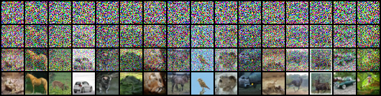
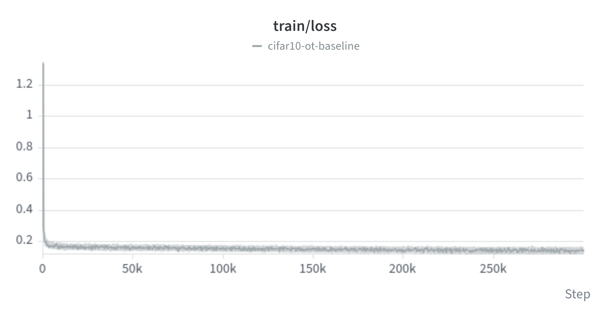
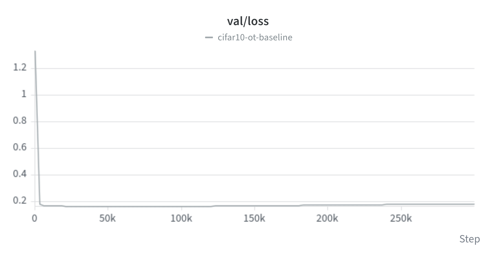
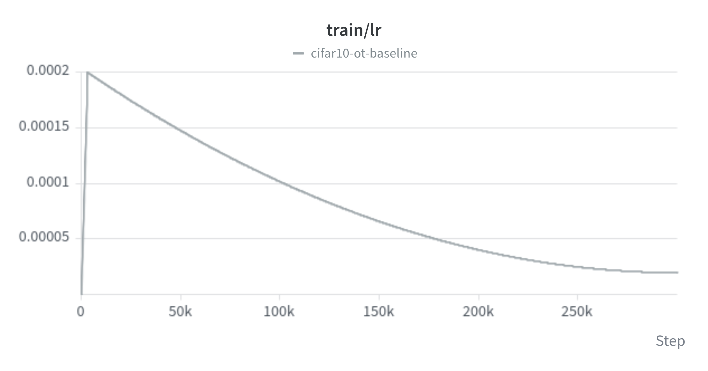
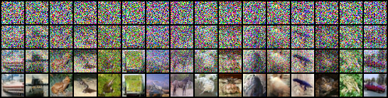
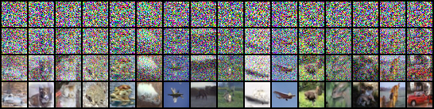

# Flow Matching from Scratch

A from-scratch PyTorch implementation of **Conditional Flow Matching with Optimal Transport paths** ([Lipman et al., 2022, arXiv:2210.02747](https://arxiv.org/abs/2210.02747)), trained on MNIST and CIFAR-10 with a hand-written UNet.

The goal of this project is to understand every component of a modern generative pipeline by building it myself: the vector-field network, the flow matching objective, multi-GPU training, and ODE sampling. No diffusion library is used.



## Method

The model learns a time-dependent vector field `v_θ(x, t)` that transports Gaussian noise (`t = 0`) to data (`t = 1`).

For a data sample `x1` and noise `x0 ~ N(0, I)`, the OT conditional path is
$$
x_t = t * x1 + (1 - (1 - \sigma_min) * t) * x0
$$
$$
u_t(x_t | x1) = (x1 - (1 - \sigma_min) * x_t) / (1 - (1 - \sigma_min) * t)
$$

and the network is trained with the regression loss `E ‖ v_θ(x_t, t) - u_t(x_t | x1) ‖²` with `t ~ U(0, 1)`.

Sampling integrates the learned ODE `dx/dt = v_θ(x, t)` from `t = 0` to `t = 1` with Euler steps.

## Features

- **UNet written from scratch** (`model.py`): sinusoidal time embedding, ResNet blocks with time conditioning, self-attention blocks, skip connections, configurable depth and channel widths. The block layout (down blocks, mid block, up blocks with skip connections) is inspired by the `UNet2DModel` architecture shown in the [Hugging Face Diffusion Course, Unit 1](https://huggingface.co/learn/diffusion-course/unit1/3); the code itself is written from scratch, without importing `diffusers`.
- **Flow matching objective** with the OT path (`vf_model="OT"`) and configurable `sigma_min`.
- **Multi-GPU training** with DDP (`torchrun`), gradient accumulation to reach a target effective batch size, and `DistributedSampler`.
- **Performance**: `torch.compile`, bf16 autocast, fused AdamW, weight decay only on matrices.
- **LR schedule**: linear warmup followed by polynomial decay.
- **Experiment tracking** with Weights & Biases: train/val loss, learning rate, gradient norm, throughput, and a sample grid logged during training.
- **Trajectory visualisation**: generated grids show the same samples at `t = 0`, `1/3`, `2/3` and `1`.
- **Config via dataclasses**: every field of `UNetConfig` and `TrainConfig` is automatically exposed as a CLI flag.

## Project structure

```
src/flow_matching_from_scratch/
├── config.py        # UNetConfig, TrainConfig (+ LR schedule)
├── model.py         # UNet, attention, ResNet blocks, optimizer setup
├── data.py          # MNIST / CIFAR-10 loaders, infinite loader
├── trainer.py       # training loop, evaluation, DDP, logging
├── generate.py      # Euler sampling and trajectory grids
├── distributed.py   # DDP setup / teardown
└── train.py         # entry point, CLI parsing
```

## Installation

The project uses [uv](https://github.com/astral-sh/uv).

```bash
git clone https://github.com/mathiscr/flow-matching-from-scratch.git
cd flow-matching-from-scratch
uv sync
```

## Usage

Single GPU:

```bash
TORCHINDUCTOR_COMPILE_THREADS=1 uv run python src/flow_matching_from_scratch/train.py --dataset CIFAR10 --in_channels 3 --out_channels 3 --image_size 32
```

Multi-GPU (2 GPUs on one node):

```bash
TORCHINDUCTOR_COMPILE_THREADS=1 uv run torchrun --standalone --nproc_per_node=2 src/flow_matching_from_scratch/train.py \
  --dataset CIFAR10 --in_channels 3 --out_channels 3 --image_size 32 \
  --name cifar10-ot --group cifar10
```


Any field of the configs can be overridden from the command line (`--max_lr 2e-4`, `--batch_size 64`, `--max_steps 100000`, ...). The tuple `block_out_channels` is not exposed to the CLI; edit its default in `config.py`.

Wandb is not used in the config by default so to use it you must use it flag `--use_wandb`
If wandb is not used, the only way to see the samples during the training is by looking at the res dir (you'll see only the latest images generated). If wandb is activated, you'll be able to have the whole images gnerated during all the training.

```bash
TORCHINDUCTOR_COMPILE_THREADS=1 uv run torchrun --standalone --nproc_per_node=2 src/flow_matching_from_scratch/train.py \
  --dataset CIFAR10 --in_channels 3 --out_channels 3 --image_size 32 \
  --name cifar10-ot --group cifar10 --use_wandb
```

### Main hyperparameters (CIFAR-10 run)

| Parameter | Value |
|---|---|
| UNet channels | (128, 256, 256), 2 layers per block |
| Time embedding dim | 512 |
| Effective batch size | 256 |
| Max LR / min LR | 2e-4 / 2e-5 |
| Warmup / schedule | linear warmup, polynomial decay (power 2) |
| Optimizer | AdamW, grad clip 1.0 |
| Precision | bf16 autocast |
| Sampler | Euler, 100 steps |

## Results












| Dataset | Steps | Throughput | Notes |
|---|---|---|---|
| CIFAR-10 | TODO | ~1750 img/s on 2x RTX 3090 | UNet (128/256/256) |

**Hardware:** 2x NVIDIA RTX 3090 (24 GB) with DDP.

Training loss is not a good proxy for sample quality in flow matching (it plateaus early), so sample grids are logged to W&B throughout training.

## Notes and lessons learned

- The model must receive the same time scaling at training and sampling time (`t * 1000` in this implementation).
- Data normalisation must map pixels to `[-1, 1]`, matching the `(x + 1) / 2` used when saving images. A wrong normalisation silently produces dark samples.

## Possible extensions

- Class-conditional generation with classifier-free guidance
- Higher-order ODE solvers (midpoint, Heun)
- Higher resolutions (ImageNet 64x64, AFHQ 128x128) with attention restricted to low resolutions

## Acknowledgements

- The UNet structure is inspired by the one presented in the [Hugging Face Diffusion Course](https://huggingface.co/learn/diffusion-course/unit1/3) (`diffusers.UNet2DModel`).
- Flow matching follows the original paper below.

## Reference

Y. Lipman, R. T. Q. Chen, H. Ben-Hamu, M. Nickel, M. Le. *Flow Matching for Generative Modeling.* arXiv:2210.02747, 2022.
